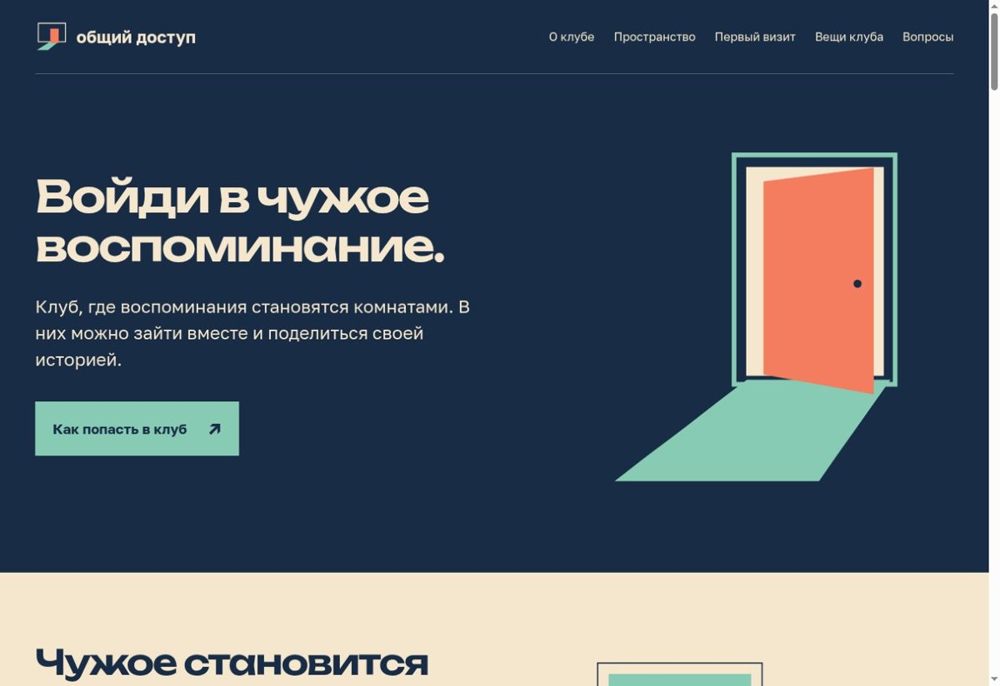

# Общий доступ

Сайт вымышленного клуба, где воспоминания становятся комнатами.

Учебный проект по основам веб-дизайна, 1 модуль.  
Влад Ханарин · БРИЦП262

[Открыть сайт](https://vkhanarin.github.io/obshchiy-dostup-1st-module/) · [Макет в Figma](https://www.figma.com/design/IhYSUO4D4bHlOJeTr9ibGo/Vlad-Khanarin?node-id=26-2)

## Идея проекта

В основе проекта — сочетание слов «клуб» и «компьютер». «Общий доступ» — место, куда люди приходят делиться воспоминаниями. В вымышленном мире клуба компьютер превращает фотографии и рассказы в комнаты, в которые можно войти вместе с другими людьми.

Название связано с функцией общего доступа к файлам. Здесь человек открывает другим часть своей истории и сам выбирает, кого пригласить. Клуб объединяет людей через знакомые места, предметы и общие моменты.

## Что есть на сайте

Одностраничный сайт знакомит с идеей клуба, его пространством и правилами общения. На нём представлены история проекта, этапы первого посещения, вещи с символикой клуба и ответы на частые вопросы.

## Визуальный стиль

Основные цвета — тёмно-синий, мятный, коралловый и кремовый. В графике используются простые геометрические формы, экран компьютера и открытая дверь — вход в воспоминание.

Для крупных заголовков используется Unbounded, для основного текста — Golos Text. Файлы шрифтов и их лицензии находятся в папке `fonts`.

## Вёрстка

Сайт сделан на HTML и CSS, без JavaScript и сторонних библиотек. Расположение блоков построено на Flexbox и Grid. Макет рассчитан на просмотр на компьютере, с фиксированной шириной содержимого 1264 px. Навигация работает через якорные ссылки, вопросы раскрываются с помощью `details` и `summary`.

Для локального просмотра достаточно открыть `index.html` в браузере.

## Использование ИИ

### Примеры запросов к ChatGPT

- **Шрифты:** подобрать шрифты с поддержкой кириллицы. В проекте используются Unbounded для заголовков и Golos Text для основного текста.
- **Анимации:** помочь убрать анимации и плавные переходы из CSS, чтобы элементы сайта оставались неподвижными.
- **Ссылки в презентации:** оформить кликабельные ссылки на макет в Figma, сайт и репозиторий GitHub.
